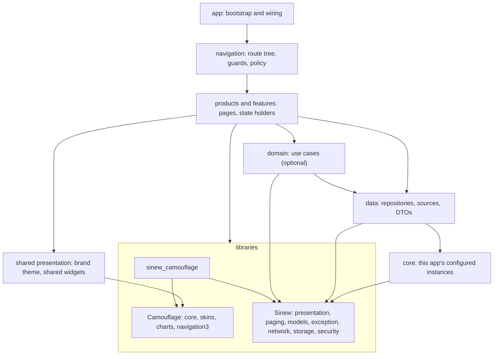
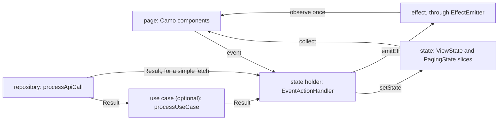
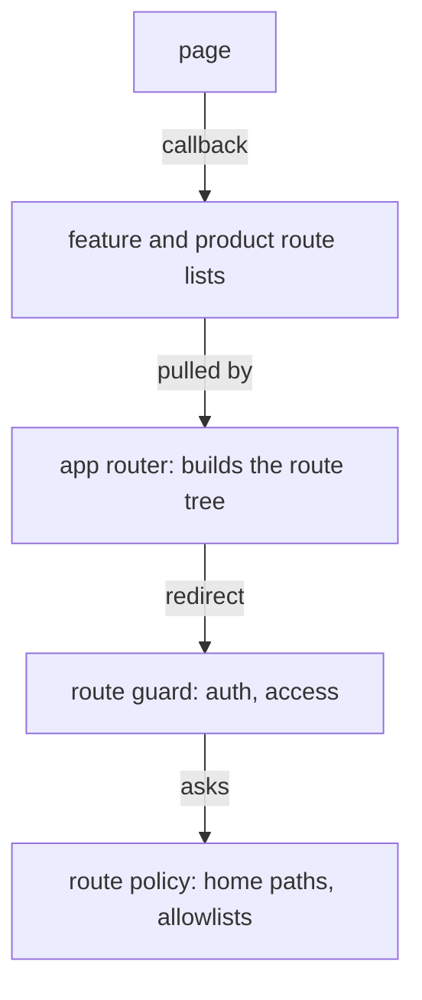

{/* Generated by docs/internal/scripts/sync_vault.py from the Sinew design notes. Edit the notes and re-run the script; changes made here are overwritten. */}

# 03 - App Architecture

## 1. Why

This is the architecture for an app built on Sinew and Camouflage. Its stack has one layer of reusable code, `libraries`, and **that layer is Sinew and Camouflage**.

The line between `libraries` and `core` is simple. Libraries hold reusable code with no app knowledge. `core` holds this app's infrastructure: its configuration of those libraries, and the services only it uses.

| Library | Provides | Answers |
|---|---|---|
| [Sinew](/guide) | models, exceptions, network, security, storage, paging, presentation base | how data becomes state |
| Camouflage | components, forms, skins, themes | how state becomes pixels |

The two libraries still don't depend on each other. Only `sinew_camouflage`, the optional glue, knows both.

## 2. Shape

### The stack



Dependencies only point down. Three rules follow from that:
- Features and products stay independent of each other. Navigation imports them, never the reverse.
- `core` depends only on libraries, never on a business module.
- A module is imported through its public API, never its internals.

### Libraries or `core`

| Capability | Comes from | What the app still writes, and where |
|---|---|---|
| Domain, entity and response models, `Result`, `ViewState` | `sinew_models` | its own models, in data |
| Error types and guards | `sinew_exception` | module and function codes |
| Crash and error reporting | the `CrashReporter` contract in `sinew_exception` | the real reporter (Sentry, for example), in `core` |
| HTTP client, timeouts, network checks, retry, polling | `sinew_network` | one configured client per backend, in `core` |
| Auth headers and token refresh | the auth layer in `sinew_network` | `TokenSource`, in `core`, plus any sign-in SDK (SSO) behind it |
| Key-value and secure storage | `sinew_storage` | typed named stores (`OrderPreferences`), in `core` |
| Database access | the guard and DAO paging helper in `sinew_storage` | the database and its schema (Room, Drift), in data |
| Biometrics, field encryption | `sinew_security` | when to offer biometrics and which fields to encrypt |
| Paging rules | `sinew_paging` | how to fetch one page |
| Event, action, state and effect base | `sinew_presentation` + adapter | each page's state holder |
| Base components | Camouflage core + a skin | nothing |
| Brand tokens | `CamoTheme` | the brand theme, in shared presentation |
| App-specific widgets (an address field, a shell) | built from `Camo*` | shared presentation |
| Forms and validators | `CamoForm`, `CamoRules` | custom `CamoRule`s, next to the forms that use them |
| Notifications | `sinew_notification` (Later) | push setup, in `core`, until that package ships |
| Remote config, analytics, constants | neither library | `core` |

### Each module's packages

Package names are the Flutter form. Kotlin swaps `_` for `-` (`sinew_network` → `sinew-network`).

| Module | Owns (the app writes this) | Uses from Sinew | Uses from Camouflage |
|---|---|---|---|
| `app` | startup, DI calls, root widget | everything, for wiring. `CrashReporter.install`. | the root `CamouflageProvider(skin, theme)` |
| `navigation` | app router, route guard, route policy | none: routing stays the app's | `camouflage-navigation3` on Compose. On Flutter, overlays use core. |
| products, features | pages, state holders, state, events, effects, route lists | `sinew_presentation`, the adapter (`sinew_riverpod` or `sinew-viewmodel`), `sinew_paging`, `sinew_camouflage` | core: `Camo*`, `CamoMessenger`. `camouflage-charts` if needed. |
| shared presentation | brand theme, renderer overrides, widgets used by 2+ modules | `sinew_l10n`, `sinew_exception` (for error text) | core, and the chosen skin |
| domain | use cases | `sinew_models`, `sinew_exception` (`processUseCase` on Flutter, `processResult` on Kotlin) | none |
| data | repositories, API clients, DTOs, envelopes, DAOs | `sinew_models`, `sinew_exception`, `sinew_network` (`processApiCall`), `sinew_storage` (`processStorageCall`) | none |
| core | configured clients, typed stores, `TokenSource`, `CrashReporter`, analytics, session, constants | `sinew_network`, `sinew_storage`, `sinew_security`, `sinew_exception` | none |
| tests | | `sinew_testing` | |
| debug builds | | `sinew_devtools`, `sinew_devtools_ui` | |

Camouflage stops at presentation: below the state holder, nothing imports it. Sinew stops at state: no Sinew package except `sinew_camouflage` knows a component.

### Dependency rules

| Module | May depend on | Must not depend on |
|---|---|---|
| `app` | everything, for bootstrap and wiring only | no limit, but it holds no business screens |
| `navigation` | features, products, shared presentation, core, libraries, for route composition | no limit, but features and products never import it |
| features | data, domain, shared presentation, core, libraries | products, navigation, other features' UI |
| products | data, domain, shared presentation, core, libraries | other products, features' UI internals, navigation |
| shared presentation | Camouflage, `sinew_l10n`, `sinew_exception` | features, products, navigation, data, core |
| domain | data contracts, Sinew | Camouflage, UI, navigation |
| data | core, Sinew | Camouflage, features, products, UI |
| core | Sinew | Camouflage, any business module |
| any module | public APIs of allowed modules | internals of another module |

### The stack per platform

| Role | Flutter | Kotlin (Android, KMP) | Library |
|---|---|---|---|
| Module | Dart package | Gradle module | |
| Versions | caret ranges, lockstep | `sinew-bom`, Camouflage's BOM | |
| UI | Widget | Composable | Camouflage |
| State holder | Riverpod notifier | ViewModel | `sinew_presentation` + `sinew_riverpod` / `sinew-viewmodel` |
| Injector | GetIt + Riverpod | Koin | plain factories, or `sinew_riverpod_providers` |
| Remote source | Retrofit on Dio | Ktor | `sinew_network` |
| Key-value and secure storage | | | `sinew_storage` |
| Database | Drift | Room, SQLDelight | `sinew_storage` guard and DAO helper |
| Navigation | go_router | Navigation Compose, Navigation 3 | `camouflage-navigation3` for overlays on Compose |

Native iOS (Swift) isn't part of this stack, because neither library has a Swift API. iOS is reached through Kotlin Multiplatform or Flutter.

### Choosing a size

Every shape keeps the same layers, and only some are real modules. `:name` is a module, `.name` a package inside its nearest module. The libraries layer is the same at every size.

| Shape | Modules | Fits |
|---|---|---|
| Simple | `:app` (`.feature`, `.presentation`, `.core`, `.data`) | one team, a few screens |
| Modular simple | `:app`, `:feature` (`.presentation`), `:core` (`.data`) | features that build and test on their own |
| Full modular | `:app`, `:feature`, `:presentation`, `:core`, `:data` | several data capabilities, shared UI |
| Modular with navigation | adds `:navigation` | features that must not know each other's routes |
| Modular with dynamic features | adds `:dynamic-feature` under navigation | features delivered on demand. An Android mechanism: a cross-platform app stays on the previous shape. |

### Inside a page



| Layer | Holds | Rule |
|---|---|---|
| Presentation | page, event, state, effect, state holder | Event → Action → State + Effect. Effects are consumed once and stay out of render state. |
| Domain (optional) | use cases | Business orchestration: multi-repository flows and branching. It starts in the feature and moves to a shared domain once 2+ modules use it. A simple fetch skips it. |
| Data | repository, local and remote sources, DTOs | Data access, mapping and error normalizing, with no business branching. The interface is public; the implementation is private. |

DTOs stay private to data. Upper layers see `Domain` models wrapped in `Result`. The state holder turns `Result` into `ViewState`, and keeps the previous data on failure.

### From a state to a component

| State | Page draws | With |
|---|---|---|
| `Loading()` | a placeholder from the first frame | `CamoSkeleton` |
| `Loading(data)` | the content and a refresh indicator | the content + `CamoProgressBar` |
| `Done(data)` | the content (an empty list is still `Done`) | any component |
| `Failed(error)` | the problem, in the page, with a retry | `CamoBanner` with a retry action |
| `Failed(data, error)` | the content, and the problem above it | the content + `CamoBanner` |
| `PagingState` | a paged list | `state.toCamo(localizer)` → `CamoPagedList` |
| an action slice (`submitting: Boolean`) | a busy button | `CamoButton(loading = submitting)` |
| an error or success effect | one message | `CamoMessenger.show(…, tone)` |
| a navigation effect | nothing: the page calls its callback | the route's callback |

Errors become text only at display time: `error.displayMessage(localizer)`. Camouflage takes text, and the text follows the current language.

`sinew_camouflage` covers paged lists only. Camouflage has no matching type for a plain `ViewState`, so shared presentation holds one small widget for it, like `AsyncSection` in §3.

### Navigation



Modules never import the router; the router pulls each module's route list. Pages emit callbacks, and access rules live in the policy, not in pages. Repository and domain code never triggers navigation: a state holder emits an effect, and the page calls its callback.

Neither library ships a router. Camouflage only makes its dialogs and sheets work with the platform's navigator.

### Dependency injection

Each module exposes its own register function. The app calls them in dependency order: core, data, domain, features. The module that owns a data interface binds it to its implementation.

The injector holds long-lived objects: clients, stores, sources, repositories, use cases. A page state holder follows its state tool's lifecycle and resolves use cases from the injector. No Sinew or Camouflage package registers itself ([Architecture](/guide/foundations/architecture)), so these register functions are the only wiring.

### Module layout

| Module | Public | Private |
|---|---|---|
| feature, product | route list, `di` | `presentation/{journey}`: page, state holder, state, event, effect, widgets |
| domain | results, use cases, `di` | implementation |
| data | repository interfaces, `Domain` models, `di` | implementation, sources, DTOs, envelopes |
| core | configured instances, typed stores, `di` | setup details |

## 3. API

This note adds no library API. These are the shapes an app writes, in pseudocode.

**A module's registration:**

```
// core: the app's own configuration of Sinew's mechanism
fun registerCore(injector) {
    injector.single<TokenSource> { SessionTokenSource(injector.get()) }
    injector.single("main") { SinewHttp.client(SinewConfig(baseUrl = env.mainApi, anonymousPaths = {"/auth/login"}), injector.get()) }
}

// data: public
fun registerOrderData(injector) {
    injector.single<OrderRepository> { OrderRepositoryImpl(api = OrderApi(injector.get("main")), dao = injector.get()) }
}

// app: the only place that knows the order
fun main() {
    CrashReporter.install(MyCrashReporter())
    registerCore(injector)
    registerOrderData(injector)
    registerOrderDomain(injector)
    registerOrderFeature(injector)
    run { CamouflageProvider(skin = MinimalSkin, theme = brandTheme(mode)) { AppRouter(routes = orderRoutes + accountRoutes) } }
}
```

**One screen through every layer:**

```
// data: a guard turns failures into typed exceptions
class OrderRepositoryImpl : OrderRepository {
    fun order(id) = processApiCall("ORD", "GO") { api.order(id) }          // Result<Order>
    fun cancel(id) = processApiCall("ORD", "CO") { api.cancel(id) }
}

// feature: a load fails into state, an action fails as an effect
class OrderDetailViewModel(repo) : EventActionHandler<OrderState, OrderEvent, OrderAction, OrderEffect>(OrderState()) {
    onAction(Load)      -> setState { copy(order = Loading(order.dataOrNull)) }
                           repo.order(id).fold(
                               onSuccess = { setState { copy(order = Done(it)) } },
                               onFailure = { setState { copy(order = Failed(order.dataOrNull, it)) } })
    onAction(Cancel)    -> setState { copy(cancelling = true) }
                           repo.cancel(id).fold(
                               onSuccess = { emitEffect(Cancelled) },
                               onFailure = { emitEffect(ShowError(it)) })
                           setState { copy(cancelling = false) }
}

// feature: the page sends events, renders state, reacts to effects
fun OrderDetailPage(onCancelled: () -> Unit) {
    ObserveEffects(vm.effects) {
        Cancelled -> onCancelled()                                          // navigation stays with the route
        ShowError -> messenger.show(it.error.displayMessage(localizer), tone = Error)
    }
    AsyncSection(state.order, onRetry = { vm.onEvent(RetryTapped) }) { order ->
        OrderSummary(order)
        CamoButton("Cancel order", onClick = { vm.onEvent(CancelTapped) }, loading = state.cancelling)
    }
}

// shared presentation: one rendering rule for plain ViewState slices
fun AsyncSection(state: ViewState<T>, onRetry, content: (T) -> Unit) {
    if (state is Failed) CamoBanner(state.error.displayMessage(localizer), tone = Error, actions = retry(onRetry))
    when {
        state.dataOrNull != null -> content(state.dataOrNull)
        state is Loading         -> CamoSkeleton.listItem()
    }
}
```

| Name | Kind | Lives in | For |
|---|---|---|---|
| `registerX(injector)` | function | each module's public API | the module's own bindings |
| route list | value | each feature or product | what the router pulls |
| `onX: () -> Unit` on a page | callback | the page | how a page leaves, without knowing the router |
| `AsyncSection` | widget, an example name | shared presentation | one rendering rule for plain `ViewState` slices |

## 4. Build steps

1. Create the sample app on the **Modular with navigation** shape, with one feature and one data module.
2. Add Sinew and Camouflage as published packages, and give `core` only the app's own configuration.
3. Add an import check for the dependency rules above: a dependency that isn't allowed fails the build.
4. Add one register function per module, called in order from `app`.
5. Define the brand theme in shared presentation and install `CamouflageProvider` in `app`.
6. Build one list page: repository → `Pager` → `PagingState` → `toCamo` → `CamoPagedList`.
7. Build one detail page with the code in §3: a load that fails into state, and an action that fails as an effect.
8. Add a route guard and a policy, and leave the page by its callback.
9. Do this on both platforms, on two skins, to show that no layer below the page changes with the skin.

**Done when**
- [ ] The sample app builds on Kotlin and Flutter, and CI rejects a forbidden import (shown by adding one on purpose).
- [ ] `core` holds no generic network, exception, model, storage, security or UI code: only what the table in "Libraries or `core`" leaves to it.
- [ ] Below the state holder, no module imports Camouflage. No page imports a DTO, a source or a router.
- [ ] Swapping the skin in `app` restyles every page with no other change.
- [ ] A failed load stays visible with a retry. A failed action shows one message, and doesn't repeat on rebuild.

## 5. Edge cases

| Case | Decided behavior |
|---|---|
| A slice not requested yet | A nullable slice, `ViewState<T>?`. `ViewState` has no idle state ([ADR-11](/guide/project/decisions)). |
| A paged list refreshes | It drops its items. Keeping previous data on failure applies to single items, not to a paged refresh ([Paging](/guide/packages/paging)). |
| A simple fetch | The state holder depends on the repository directly. A use case appears when there is orchestration. |
| A use case needed by a second module | It moves from the feature to shared domain. Features never import each other. |
| A widget needed by a second module | It moves to shared presentation, built from `Camo*`. |
| A helper with no app knowledge, used by a second app | It moves to Sinew or Camouflage. It doesn't grow back in `core`. |
| A capability neither library has yet (analytics, notifications) | It stays in `core`, behind the app's own interface, so it can move when a package ships. |
| A search typed quickly | The state holder debounces, and the pager drops stale responses, so a slow response never overwrites a newer one. |
| Secrets and personal data | In `SecureStore`, or encrypted with `FieldCipher`. Never in logs, error messages or persisted state. The network layer redacts its logs. |
| A small app | It keeps the same layers as packages in one module. The dependency rules still apply, without a build to enforce them. |
| App-level state (session, role) | It lives in `core`, and the route policy reads it. A page's state holder never holds it. |
