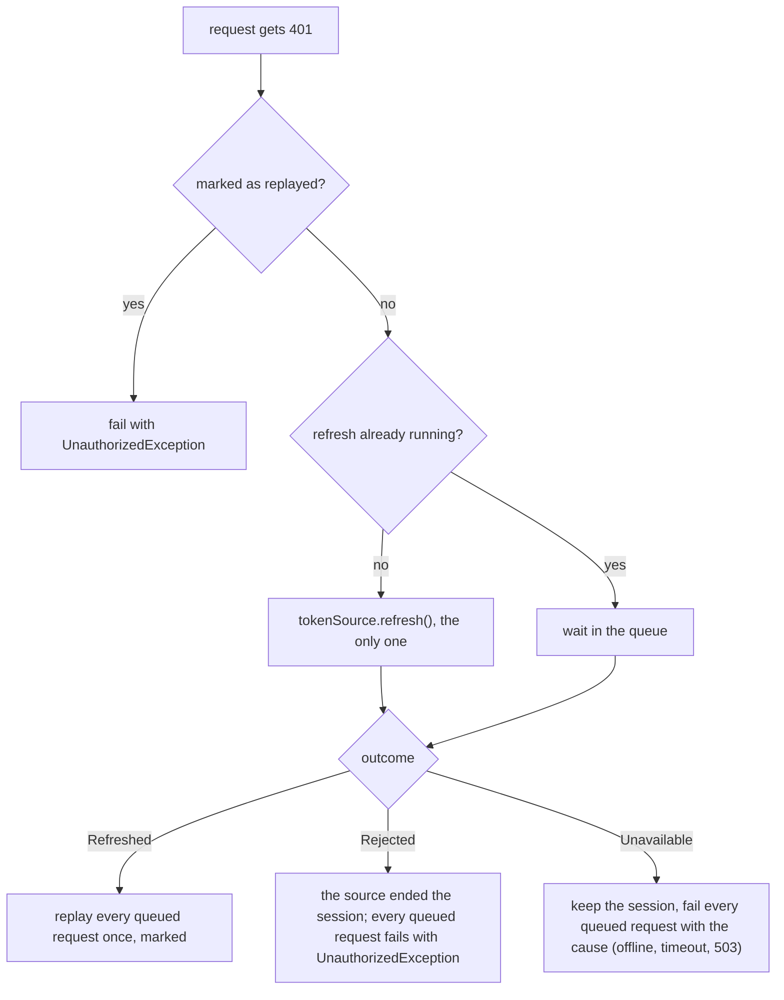

{/* Generated by docs/internal/scripts/sync_vault.py from the Sinew design notes. Edit the notes and re-run the script; changes made here are overwritten. */}

# 06 - Network

## Concept {#concept}

### 1. Why

Every app rebuilds the same HTTP setup. The hard parts are also the easiest to get wrong:
- **Token refresh.** Ten requests hit 401 at once, two refreshes race, and a rotating refresh token gets invalidated.
- **Translating HTTP errors into something a page can act on.**
- **Timeouts on every request.**
- **Logging that never leaks a token.**
- **Never sending a token to a host it doesn't belong to.**

`sinew_network` provides those parts as **separate pieces the app installs on its own client when it needs them** (Dio interceptors on Flutter, Ktor plugins on Kotlin), plus an optional preset that installs them all from one config, and the source guard `processApiCall`. The app keeps writing its API clients directly on Dio or Ktor. Sinew doesn't hide the HTTP library.

### 2. Shape

#### What the app supplies

```
SinewConfig(
    baseUrl: String,
    connectTimeout = 15s,
    readTimeout = 30s,                        // reads
    writeTimeout = 60s,                       // writes: repeating them is costly, so they get longer
    logHttp = false,                          // debug builds only
    anonymousPaths: Set<String> = {},         // never get a token, never trigger a refresh (sign-in, register, OTP, password reset, refresh).
                                              // Matched relative to baseUrl's path: with baseUrl ".../v1", "/auth/login" matches "/v1/auth/login".
    locale: () -> String,                     // read per request, sent as Accept-Language
    defaultHeaders: () -> Map<String, String> = {},   // app version, API key, device id: read per request. Every name here is redacted by devtools.
    errorBodyReader: ErrorBodyReader = ErrorBodyReader.default,
)

interface TokenSource {
    accessToken(): String?                    // in memory
    refresh(): RefreshOutcome                 // gets a new pair from the backend and stores it
    clear()                                   // the session ended: drop tokens, void any refresh still running, tell the app's session service
}

RefreshOutcome = Refreshed | Rejected | Unavailable(cause: SinewException)
//  Rejected:    the backend refused the refresh token, or the session ended while refreshing → the session is over;
//               the source ends it itself, unless another session started meanwhile
//  Unavailable: the refresh couldn't be completed (offline, timeout, 5xx) → the session is kept

// Sinew's ready implementation: the app supplies only the backend call and where the refresh token is kept
class SessionTokenSource(store: RefreshTokenStore, call: RefreshCall) : TokenSource
interface RefreshTokenStore { read(): String?, write(token: String), delete() }     // the app adapts its SecureStore in one line
interface RefreshCall { refresh(refreshToken: String): RefreshResult }               // the app's backend call, on a client without the auth layer
RefreshResult = Tokens(access: String, refresh: String) | Rejected | Unavailable(cause: SinewException)

interface ErrorBodyReader { read(status: Int, body: String?): ErrorBody? }
ErrorBody(message: String?, fieldErrors: Map<String, List<String>>?)
// default: reads JSON "message" and "errors" ({ field: [messages] }), returns null for anything unreadable
```

The app builds **one client per backend** (`SinewHttp.dio(config, tokenSource)` / `SinewHttp.client(config, tokenSource)`) and registers each under a name in its DI.

#### The layers, in order

Each request passes through these layers, outermost first. They're Dio interceptors on Flutter and Ktor plugins on Kotlin.

| # | Layer | Does |
|---|---|---|
| 1 | **Timeout** | Sets the deadline by method: reads use `readTimeout`, writes (`POST`, `PUT`, `PATCH`, `DELETE`) use `writeTimeout`. Every request has one. |
| 2 | **Headers** | Adds `Accept: application/json`, `Accept-Language` from `locale()`, and `defaultHeaders()`. |
| 3 | **Auth** | Adds `Authorization: Bearer …` for requests to its own host, except anonymous paths. Refreshes on 401 (rules below). |
| 4 | **Fault injection** | Devtools hook: forces a status, a delay or a dropped connection on a matching path. Does nothing without devtools. |
| 5 | **Recorder** | Devtools hook: records the request and response, redacted when recorded. Does nothing without devtools. |
| 6 | **Redacting log** | Logs method, path, status and duration when `logHttp` is on. Redacts `Authorization`, cookies and the bodies of auth endpoints. |

Fault injection sits inside auth, so a forced 401 exercises the real refresh path.

#### The auth layer



| Rule | Why |
|---|---|
| **Single-flight:** while a refresh runs, other 401s wait for its outcome instead of starting their own | Parallel refreshes race, and with rotating refresh tokens the second invalidates the first |
| A 401 for a request sent with an **older** token than the current one replays at once, without refreshing | A refresh already finished while that request was in flight. Refreshing again would break "exactly one refresh". |
| The refresh runs in a scope owned by the client, not by the first caller | If the first caller is cancelled (its page closed), the other waiters still get the outcome |
| A replay goes out through the auth layer's own path, and its errors are handed back to the caller like any other error | A failing replay can never wait on the auth layer that is waiting on it |
| A replayed request is **marked**. A second 401 on it fails instead of refreshing again. | Otherwise a replay waits on a refresh that waits on the replay: a deadlock |
| Anonymous paths never get a token and never trigger a refresh | A 401 there means "wrong credentials", not "expired token" |
| The refresh call itself bypasses the auth layer | A failing refresh must not refresh itself |
| `Rejected`: every queued request fails with `UnauthorizedException`. The **token source** ends the session, only if it's still the session the refresh started in; the auth layer never calls `clear()` | The app's session service routes to sign-in. A refresh voided by another user's sign-in must not sign them out |
| `Unavailable` **keeps** the session: queued requests fail with the cause (`NoInternetConnectionException`, `RequestTimeOutException`, `ServiceUnavailableException`) | A refresh that fails because the network or the backend is down must not sign the user out. The page shows a retryable error; the next request tries again. |
| A token is attached only to requests whose host is the client's `baseUrl` host | An absolute URL to a CDN or a storage bucket never receives the user's token |
| `reset()` on sign-out clears the queue and the refreshing flag, and `clear()` voids a running refresh through the session epoch | Nothing leaks into the next user's session, and a late refresh result is never stored |
| A redirect to another host is followed **without** the `Authorization` header | A redirect can't carry the user's token off the backend's host |

#### Sign-out during a refresh: the session epoch

A refresh is a network call, so it can finish after the user signed out. If it then stored its new tokens, the user (or the next user on the device) would be silently signed back in. `SessionTokenSource` prevents that with a **session epoch**, a counter that `clear()` increments:

```
refresh():
    epoch = currentEpoch                         // remember which session started this refresh
    result = call.refresh(store.read())
    lock:
        if currentEpoch != epoch: return Rejected            // signed out meanwhile: discard the result, store nothing
        if result is Tokens: store.write(result.refresh), access = result.access, return Refreshed
        …
clear():
    lock: currentEpoch += 1, access = null, store.delete()
```

The check and the write happen under one lock, so no ordering of `clear()` and a finishing refresh can store tokens after sign-out. An app that writes its own `TokenSource` must give `clear()` the same guarantee; the rule is part of the interface's contract.

#### The source guard

```
processApiCall(module, function, call: () -> Envelope<R>): Result<R> =
    message = ""
    processCall(module, function, Repository, apiHandlers(module, function)) {
        envelope = call()                                      // a non-2xx status already threw, with the error body read by ErrorBodyReader
        failure = envelope.failure()                           // null unless the app's envelope maps a failure inside a 2xx body
        if failure != null:
            throw failure.fieldErrors != null
                ? ValidationException(module, Repository, function, fieldErrors = failure.fieldErrors, message = serverOrLocal(failure.message, "sinew.error.validation"))
                : ApiErrorException(module, Repository, function, message = serverOrLocal(failure.message, "sinew.error.generic"))
        message = envelope.message() ?: ""
        envelope.toDomain()                                    // inside the guard: a mapping bug becomes ParseException
    }.withMessage(message)                                     // a success becomes Success(data, message); a failure is unchanged

processOptionalApiCall(module, function, call): Result<R?>    // the same, except a 404 is success(null)

serverOrLocal(text, key) = text is not blank ? Server(text) : Local(key, fallback = English for key)
```

`apiHandlers` turns HTTP library errors into the [Exception](/guide/packages/exception) types, first match wins:

| # | Matches | Produces |
|---|---|---|
| 1 | a cancelled request (Flutter) | `CancelException`. On Kotlin, cancellation is rethrown before handlers run. |
| 2 | a connect, send or receive timeout | `RequestTimeOutException` |
| 3 | no connection, DNS failure, connection refused or reset | `NoInternetConnectionException` |
| 4 | a response with status 400 or 422 whose body has field errors | `ValidationException` |
| 5 | status 401 (after the auth layer gave up) | `UnauthorizedException` |
| 6 | 403, 404, 409 | `ForbiddenException`, `NotFoundException`, `ConflictException` |
| 7 | 429 | `RateLimitedException`, with `retryAfter` from the `Retry-After` header (seconds or an HTTP date) |
| 8 | 503, 504 / any other 5xx (500, 501, 502, 505…) | `ServiceUnavailableException` / `ServerException` |
| 9 | any other non-2xx status with a readable message | `ApiErrorException` |
| 10 | any other non-2xx status | `UndefinedErrorResponseException` |
| 11 | JSON that doesn't fit the DTO, including an enum value the DTO can't fall back from | `ParseException` |
| 12 | `EnvelopeDataMissing` (shared) | `ParseException` |

For rows 4–10, the **client** has already read the error body: when a response fails, its error layer runs the client's own `errorBodyReader.read(status, body)` and attaches the result to the error as an `HttpStatusError(status, errorBody, retryAfter)`. The reader belongs to each client's `SinewConfig`, so the handlers never need it; they classify `HttpStatusError` by status. A readable message becomes `Server(text)`; otherwise the type's local key is used.

#### Retry and polling

| Helper | Does | Rules |
|---|---|---|
| `retryWithBackoff(module, function, maxAttempts = 3, initialDelay = 500 ms, maxDelay = 5 s, retryIf = { it.retryable }, block)` | Runs `block` (which returns a `Result`) again after a retryable failure, with exponential backoff and full jitter. A 429 waits at least `retryAfter`. When it gives up, it returns the **last failure unchanged**, so the user sees the real reason. | **Idempotent requests only** (reads, and writes carrying an `Idempotency-Key`). Retry in one layer only: never around a call that's already retried. |
| `poll(module, function, interval = 2 s, maxInterval = 10 s, timeout = 60 s, until: (T) -> Boolean, block)` | Calls `block` until `until(data)` is true, growing the interval by 1.5× with jitter | Retryable failures keep polling until the timeout. A non-retryable failure stops at once and is returned. The timeout gives `PollingTimeOutException`. |

There's **no automatic retry** in the client. A failed request shows its error with a retry action, and the user decides.

#### Network checker

```
NetworkChecker { isOnline(): Boolean, changes: stream of NetworkStatus }   NetworkStatus { Online, Offline }
```

It's for the UI (an offline banner, disabling a submit button). It never decides a request's error type. That comes from the request's own failure, because "connected to Wi-Fi" doesn't mean "the backend is reachable".

#### Environment rules

| Rule | Why |
|---|---|
| The base URL and keys come from the app's build configuration, passed in `SinewConfig` | One source per environment. Nothing hard-coded in API clients. |
| Accepting invalid certificates is possible only through a debug-only option that release builds can't set | A leftover "accept any certificate" disables TLS checks in production |
| Certificate pinning, when an app wants it, is configured on the client's engine (each platform note says how) | One place, next to the rest of the client setup |
| `logHttp` is off by default and must never be on in release builds | Logs end up in device logs and bug reports |

### 3. API

| Name | Signature (pseudocode) | For |
|---|---|---|
| `SinewConfig` | as above | per-client configuration |
| `TokenSource` | `accessToken(): String?`, `refresh(): RefreshOutcome`, `clear()` (voids a running refresh) | where tokens live, how they refresh |
| `SessionTokenSource` | `SessionTokenSource(store: RefreshTokenStore, call: RefreshCall)` | the ready, epoch-guarded implementation |
| `RefreshTokenStore`, `RefreshCall`, `RefreshResult` | as above | what the app supplies to `SessionTokenSource` |
| `RefreshOutcome` | `Refreshed \| Rejected \| Unavailable(cause)` | what a refresh attempt concluded |
| `ErrorBodyReader`, `ErrorBody` | `read(status, body): ErrorBody?`, `ErrorBodyReader.default` | reading the backend's error messages |
| `SinewHttp` | Flutter `SinewHttp.dio(config, tokenSource, extraInterceptors = []): Dio`. Kotlin `SinewHttp.client(config, tokenSource, engine = platform default, configure = {}): HttpClient`. | building one client |
| `resetAuth` | `SinewHttp.resetAuth(client)` | sign-out: clear the auth layer's queue and flag |
| `processApiCall` | `processApiCall(module, function, call: () -> Envelope<R>): Result<R>` | the source guard for HTTP calls |
| `processOptionalApiCall` | `processOptionalApiCall(module, function, call): Result<R?>` | 404 → `null` |
| `retryWithBackoff` | as above, `→ Result<T>` | explicit retries |
| `poll` | as above, `→ Result<T>` | bounded waiting for a backend process |
| `NetworkChecker` | `isOnline()`, `changes` | connectivity for the UI |
| devtools hooks | `RecorderLayer`, `FaultInjectionLayer`, no-ops until devtools install them | see DevTools |

### 4. Build steps

1. `SinewConfig`, `TokenSource`, `RefreshOutcome`, `ErrorBodyReader` with its default, and tests that the default reader:
   - reads `message` and `errors` from an error body;
   - returns null for HTML, empty or non-JSON bodies.
2. The timeout and headers layers, tested against a mock server:
   - read and write deadlines;
   - `Accept-Language` follows a locale change between two requests;
   - default headers are read per request.
3. The auth layer, test first, against a mock server that counts refresh calls. Tests:
   - ten parallel 401s cause exactly one refresh, and all ten replay once;
   - `Rejected` clears the session and fails all ten with `UnauthorizedException`;
   - `Unavailable` keeps the session and fails them with the cause;
   - a replayed request that gets 401 again fails without a second refresh;
   - anonymous paths never get a token, including with a `baseUrl` path prefix (`/v1`);
   - sign-out while a refresh is running: the refresh's tokens are not stored, and waiters fail with `UnauthorizedException`;
   - a 401 for a request sent with an older token replays without a second refresh;
   - the first caller cancelled mid-refresh: the other waiters still get the outcome;
   - a replay that returns 401, and one that returns 500, fail the caller without blocking later requests;
   - a cross-host redirect drops `Authorization`;
   - a request to another host never gets a token;
   - sign-out during a refresh fails the queue and leaves no state behind.
4. `processApiCall` and `processOptionalApiCall`, with one test per handler row. That includes a 400/422 error body with and without field errors, an envelope whose `failure()` is set (with and without `fieldErrors`), `Success.message` from `message()`, a 404 on the optional variant, a 429 with `Retry-After` in seconds and as a date, and an HTML 502 page.
5. `retryWithBackoff` and `poll` with a virtual clock. Tests:
   - attempts and delays;
   - a non-retryable failure stops at once;
   - a 429 waits at least `retryAfter`;
   - the polling timeout.
6. `NetworkChecker` per platform.
7. The redacting log, with a test that no logged line contains a bearer token or an auth endpoint's body.

#### Platforms

| Platform | Notes |
|---|---|
| Flutter web | Dio's browser adapter can't set a send timeout or pin certificates. Those settings are ignored there, as documented in the Flutter note. |
| Kotlin wasmJs | Ktor's JS engine follows the browser's own TLS and redirect handling. Pinning isn't available. |

**Done when**
- [ ] Every test in step 3 passes against a real HTTP mock on every target.
- [ ] Every handler row has a test that produces its exception type and code.
- [ ] No log line, in any test, contains a bearer token.
- [ ] A refresh failing because the backend is down never signs the user out.

### 5. Edge cases

| Case | Decided behavior |
|---|---|
| Ten requests get 401 at once | One refresh. The others wait and replay once with the new token, or all fail together. |
| The refresh token was rejected | `Rejected`: the session ends and every waiting request fails with `UnauthorizedException`. |
| The refresh call times out or gets a 503 | `Unavailable`: the session is kept, waiting requests fail with the cause, and the page shows a retryable error. |
| The user signs out while a refresh runs | The app calls `resetAuth` and `tokenSource.clear()`, which bumps the session epoch. When the refresh finishes, its tokens are not stored (the epoch moved), and waiting requests fail with `UnauthorizedException`. |
| A 401 arrives for a request sent before a refresh that has since finished | It replays with the new token. No second refresh. |
| The first request that triggered a refresh is cancelled | The refresh keeps running in the client's scope, and the other waiters get its outcome. |
| The replay itself fails (a second 401, a 500, offline) | The caller gets that failure. The auth layer is never blocked by its own replay. |
| A replayed request gets 401 again | It fails with `UnauthorizedException`. No second refresh. |
| A timeout on a non-idempotent write (`POST`) | Returned as `RequestTimeOutException`, never retried automatically. The app decides; an `Idempotency-Key` makes a retry safe. |
| Offline at app start | Requests fail with `NoInternetConnectionException`. The network checker shows offline, and pages offer retry. |
| A 429 with `Retry-After` | `RateLimitedException.retryAfter` is set, and the message names the wait. `retryWithBackoff` waits at least that long. |
| A redirect | GET redirects are followed within the same host. A redirect to another host is followed without the `Authorization` header. |
| A 5xx the table doesn't name (501, 505, 507…) | `ServerException`, with the backend's text if readable. Every 5xx is the backend's side, never `ApiErrorException` or `UndefinedErrorResponseException`. |
| A 408 status | Not a timeout: rows 2 and 3 cover the client's own deadlines and connection failures. The server answered, so it falls to row 9 or 10 (`ApiErrorException` with readable text, `UndefinedErrorResponseException` otherwise). |
| A TLS or certificate failure, including a pinning mismatch | `UnexpectedException`, reported. It's a security event, not "offline": showing the offline message would hide a misconfigured server or an interception. |
| A 502 whose body is an HTML page from a proxy | The error-body reader returns null, so the message is the local `sinew.error.server`. |
| An error body with an empty `message` | Treated as unreadable: the local message for the status is shown. |
| An envelope `failure()` with an empty message | The same: the local generic (or validation) message is shown. |
| The app's language changes mid-request | That request carries the old `Accept-Language`. The next one uses the new locale. |
| An absolute URL to another host (a CDN image, a pre-signed upload) | No `Authorization` header is attached. |

:::tip[Settled during S1 (2026-10-11)]

- **Every 5xx except 503 and 504 is `ServerException`**, not only 500 and 502. A 408 status and TLS or certificate failures keep their catch-all rows: a 408 is a server answer (row 9 or 10), and a certificate failure is `UnexpectedException`, reported, on both platforms.

:::

:::tip[Settled during S3 (2026-10-11)]

- **`SinewConfig` fails fast**: a blank `baseUrl`, a timeout that isn't positive, or an anonymous path without a leading `/` throws when the config is built, not on the first request.
- **The default `ErrorBodyReader`** reads a JSON object only. A blank `message`, blank or non-string field messages and empty field lists are dropped; a field may hold one string instead of a list. An object with neither a message nor field errors, `{}` included, is unreadable (`null`).
- **`HttpStatusError` is internal.** It only travels from the client to `processApiCall`, which turns it into a `SinewException`; apps never see it, and it can open up later if an app needs it. Its own message names only the status (`HTTP 422`), because an error body may hold personal data and exception messages reach logs and crash reports.
- **One `SinewConfig` per backend**, not per endpoint. Per-endpoint needs stay on the request: `anonymousPaths` for sign-in and refresh, a header on the call, and a per-request timeout for a slow endpoint, which the timeout layer must leave alone.
- **`Retry-After`** accepts delay-seconds and the IMF-fixdate form (`Wed, 21 Oct 2015 07:28:00 GMT`). A date in the past is a zero wait. The obsolete RFC 850 and asctime forms, a negative or fractional number, or anything else is treated as no header.
- **The log reads nothing secret**: one line per exchange with the method, host, path, status and duration (or the failure's type). No header, body, query string or exception message, so a token can't reach it.
- **Redirects**: at most 5 hops, never from `https` to `http`, and a hop to another host or port drops `Cookie` as well as `Authorization`.
- **A request's own timeout and headers win** over the client's defaults, so a slow endpoint sets its deadline on that call.
- **A rejected refresh is ended by the token source, not the auth layer.** If the auth layer called `clear()` on `Rejected`, a refresh voided because another user signed in meanwhile would sign that user out. `SessionTokenSource` ends the session under its lock only when the epoch is still the one the refresh started in.
- **`Rejected` and a replayed 401 return the 401 response** to the validator, which throws `HttpStatusError(401)`; the guard maps it to `UnauthorizedException`. There's no separate rejection type.
- **`SessionTokenSource` adds `start(access, refresh)`** for sign-in (it voids any refresh from the previous session) **and `onSessionEnded`**, called on `clear()` and when the backend rejects the refresh token or none is stored: the only way the app learns the backend ended the session.
- **A refresh call that throws is `Unavailable`**, guarded as `AUTH-R-REFRESH-…` (an unexpected failure is reported), so a bug or a raw network error never signs the user out.
- **A 401 for a request whose token was cleared since it was sent** (the user signed out mid-flight) returns as is, with no refresh: refreshing could bring the session back.
- **A request with no token yet** (a cold start with only a refresh token) still refreshes on 401 and replays. **A request with its own `Authorization`** is left alone: no token, no refresh. **A one-shot streamed body** still triggers the refresh but isn't replayed, so the app's retry carries the new token.
- **Anonymous paths match exactly**, relative to `baseUrl`'s path (`/auth/login` doesn't cover `/auth/login/history`), and another port is another host.
- **Installable pieces first, the preset second.** Each layer (auth, headers, timeouts, the error-body reader, redirects, the log) is a public plugin or interceptor an app installs on its own client, alone or together, in any order the HTTP library allows. `SinewHttp.client(config, tokens)` stays as an optional preset that installs them all from one `SinewConfig`. An app that only wants the refresh logic installs only the auth layer.
- **The backend's base URL is declared once per client** (`sinewBackend(url)` on Kotlin), and the pieces that need it (request URLs, the token's host, anonymous paths) read it from there.
- **The guard walks a failure's causes.** Engines wrap their failures, so a timeout or a lost connection anywhere in the chain classifies the failure, but a TLS or certificate failure anywhere in it means it's never "offline": a handshake cut by a reset is still a reported `UnexpectedException`.
- **A plain client works too.** Without the error-body reader, the HTTP library's own status errors (Ktor's `ResponseException`, Dio's `badResponse`) are classified by status, with the local message, since the body can't be read there.
- **An envelope `failure()` with an empty field map** is an `ApiErrorException`, not a `ValidationException` with no fields.
- **`RefreshResult.from(result)`** turns a guarded refresh call into its answer, so a `RefreshCall` is only the HTTP call. A refusal (401, 403, 400 or 422 for OAuth's `invalid_grant`, a readable refusal, any other 4xx except 408 and 429) is `Rejected`; everything else, a bug included, keeps the session as `Unavailable`.
- **`retryWithBackoff` has no module or function**: its block already returns a guarded `Result`, so it never creates an exception. `poll` keeps them, for its `PollingTimeOutException`.
- **A 429 asking for longer than `maxDelay` is returned at once**, not waited out, so the page shows "Try again in 120 seconds" instead of a long spinner. Within `maxDelay`, the retry waits at least `retryAfter`.
- **`poll` uses equal jitter** (half the interval fixed, half random), so the interval still grows by 1.5× while clients spread out; `retryWithBackoff` keeps full jitter. A slow call still running at the timeout is cut, and the `PollingTimeOutException` carries the last retryable failure as its cause.
- **`NetworkChecker` starts `Online`** until the platform first reports, so an app doesn't flash an offline banner at launch, and it **has a `close()`**: monitoring runs from creation until then, one checker per app. A captive portal counts as offline where the platform can tell (Android's validation).
- **Auth is opt-out, through `anonymousPaths` only** (decided 2026-10-12). No per-request "anonymous" flag: anonymous endpoints are few (sign-in, register, OTP, password reset, refresh), so listing them once beats tagging every other endpoint, and a new endpoint gets the token unless someone deliberately lists it. Considered against the opt-in, per-endpoint header markers of an earlier in-house Dio package.

:::

## Implementation {#implementation}

<KotlinOnly>

### 1. Why {#kotlin-1-why}

This note builds the base network design on **Ktor 3**: one configured `HttpClient` per backend, the six layers as Ktor plugins, a custom auth plugin for the three-way refresh outcome, and `processApiCall`.

### 2. Shape {#kotlin-2-shape}

#### Building a client {#kotlin-building-a-client}

Each layer is a public Ktor plugin, installed alone or together on the app's own `HttpClient`:

```kotlin
val http = HttpClient(OkHttp) {
    expectSuccess = false                                           // needed by sinewErrorBody
    sinewBackend("https://api.shop.com/v1")                         // defaultRequest + the base Sinew's plugins read: written once
    install(ContentNegotiation) { json(SinewJson) }
    install(SinewHeaders) { locale = { settings.language }; defaults = { mapOf("X-App-Version" to version) } }
    install(HttpTimeout); install(SinewTimeouts) { read = 30.seconds; write = 60.seconds }
    install(SinewAuth) { tokenSource = tokens; anonymousPaths = setOf("/auth/login") }
    HttpResponseValidator { sinewErrorBody() }                      // HttpStatusError for processApiCall
    followRedirects = false; install(SinewRedirect)                 // optional: a hop limit, cookies dropped across hosts
    install(SinewLog) { logger = HttpLogger { Timber.d(it) } }      // debug only, installed last
}
```

| Plugin | Order | Fails fast when |
|---|---|---|
| `sinewBackend(url)` | any: a config function, not a plugin, since it sets `defaultRequest` | the URL is blank |
| `SinewAuth` | any: Ktor's redirect and validator always wrap it | no `tokenSource`, or an anonymous path without `/`; no base URL (from `sinewBackend` or its own `baseUrl`) on the first request |
| `SinewHeaders` | any: `ContentNegotiation` adds `Accept` later, in the body phase | |
| `SinewTimeouts` | any | a timeout isn't positive; `HttpTimeout` missing (on the first request) |
| `sinewErrorBody` | any: it's part of Ktor's own validator, outermost | |
| `SinewRedirect` | before `SinewAuth`, so each hop gets its own token decision | Ktor's `HttpRedirect` is on (`followRedirects` not `false`) |
| `SinewLog` | last, for one line per hop and replay | |

The optional preset installs all of them from one `SinewConfig`:

```kotlin
public object SinewHttp {
    public fun client(config: SinewConfig, tokenSource: TokenSource, logger: HttpLogger = HttpLogger.Default, configure: HttpClientConfig<*>.() -> Unit = {}): HttpClient
    public fun <T : HttpClientEngineConfig> client(config: SinewConfig, tokenSource: TokenSource, engine: HttpClientEngineFactory<T>, logger: HttpLogger = HttpLogger.Default, configure: HttpClientConfig<T>.() -> Unit = {}): HttpClient
    public suspend fun resetAuth(client: HttpClient)                // works on any client with SinewAuth installed
}
```

#### The auth plugin {#kotlin-the-auth-plugin}

Ktor's built-in `Auth` bearer provider refreshes once for concurrent 401s, but its refresh result is only "new tokens or nothing". Sinew's base contract needs three outcomes (`Refreshed`, `Rejected`, `Unavailable(cause)`), and a failure that carries its cause to every waiting request. So `SinewAuth` is a small custom plugin on Ktor's `HttpSend` interceptor:

```kotlin
internal val SinewAuth = createClientPlugin("SinewAuth", ::SinewAuthConfig) {
    val cfg = pluginConfig
    val refresher = SingleFlightRefresher(cfg.source, scope = CoroutineScope(SupervisorJob()))   // owned by the client, not by the first caller
    client.plugin(HttpSend).intercept { request ->
        val path = request.url.encodedPath.removePrefix(cfg.baseUrl.encodedPath.trimEnd('/'))     // anonymous paths are relative to baseUrl's path
        val anonymous = path in cfg.anonymousPaths
        val ownHost = request.url.host == cfg.baseUrl.host
        val sentWith = if (!anonymous && ownHost) cfg.source.accessToken()?.also { request.bearerAuth(it) } else null
        val call = execute(request)
        if (call.response.status != HttpStatusCode.Unauthorized || sentWith == null || request.attributes.contains(Replayed)) return@intercept call
        val outcome = if (cfg.source.accessToken() != sentWith) RefreshOutcome.Refreshed   // a refresh already finished meanwhile
                      else refresher.refresh()                                              // joins the running refresh, or starts one
        when (outcome) {
            RefreshOutcome.Refreshed -> execute(request.apply {
                attributes.put(Replayed, Unit); headers.remove(HttpHeaders.Authorization); cfg.source.accessToken()?.let { bearerAuth(it) } })
            RefreshOutcome.Rejected -> call                                                    // the 401: the validator throws, the guard maps it
            is RefreshOutcome.Unavailable -> throw outcome.cause                               // already an SinewException: passes through
        }
    }
}
```

| Part | Does |
|---|---|
| `SingleFlightRefresher` | holds a `Mutex` and the in-flight `Deferred<RefreshOutcome>`, started with `scope.async`. Waiters `await` it. Cancelling a waiter cancels only its own wait, never the refresh. `resetAuth` cancels the scope's children and starts fresh. |
| The sent-token check | a 401 for a request sent with an older token replays at once, so ten requests produce exactly one refresh even when some 401s arrive after it finished |
| The replay | goes through `execute` like any request. Its failure (a second 401, a 500) is returned to its caller; nothing waits on it, so it can't block the plugin. |
| `Rejected` | returns the 401 response; the source has already ended the session if it was still current |

The refresh call itself is made by the `TokenSource`. With Sinew's `SessionTokenSource`, the app's `RefreshCall` uses a separate `HttpClient` without `SinewAuth`, so a refresh can never refresh itself.

#### `SessionTokenSource` and the session epoch {#kotlin-sessiontokensource-and-the-session-epoch}

```kotlin
public class SessionTokenSource(
    private val store: RefreshTokenStore,
    private val call: RefreshCall,
    private val onSessionEnded: suspend () -> Unit = {},           // on clear(), and when the backend rejects the refresh token
) : TokenSource {
    private val mutex = Mutex()
    private var epoch = 0L
    private val access = AtomicReference<String?>(null)

    override fun accessToken(): String? = access.load()
    public suspend fun start(accessToken: String, refreshToken: String): Unit = mutex.withLock { epoch++; store.write(refreshToken); access.store(accessToken) }

    override suspend fun refresh(): RefreshOutcome {
        val (started, refreshToken) = mutex.withLock { epoch to store.read() }
        if (refreshToken == null) return endIfStill(started)
        val answer = when (val r = processCall("AUTH", "REFRESH", Repository, emptyList()) { call.refresh(refreshToken) }) {
            is Result.Failure -> return RefreshOutcome.Unavailable(r.error)              // a throw keeps the session
            is Result.Success -> r.data
        }
        return when (answer) {
            is RefreshResult.Unavailable -> RefreshOutcome.Unavailable(answer.cause)
            RefreshResult.Rejected -> endIfStill(started)                                 // ends the session only if it's still this one
            is RefreshResult.Tokens -> mutex.withLock {
                if (epoch != started) return@withLock RefreshOutcome.Rejected            // signed out or in meanwhile: store nothing
                store.write(answer.refresh); access.store(answer.access); RefreshOutcome.Refreshed
            }
        }
    }
    override suspend fun clear() { mutex.withLock { epoch++; access.store(null); store.delete() }; onSessionEnded() }
}
```

#### Redirects {#kotlin-redirects}

`SinewRedirect` follows `301`, `302`, `303`, `307` and `308` for `GET` and `HEAD` only, up to 5 hops. Each hop is a new request through `HttpSend`, so `SinewAuth` attaches the token only when the hop's host is the client's own. A cross-host hop never carries `Authorization`.

#### Timeouts and headers {#kotlin-timeouts-and-headers}

| Plugin | Does |
|---|---|
| `SinewTimeout` | For `GET`/`HEAD`, sets `requestTimeoutMillis` and `socketTimeoutMillis` to `readTimeout`. For other methods, `writeTimeout`. `connectTimeoutMillis` is always `connectTimeout`. |
| `SinewHeaders` | Adds `Accept: application/json`, `Accept-Language: locale()`, and `defaultHeaders()`, read on every request |
| `SinewFaults` / `SinewRecorder` | Call `hooks`. `SinewHttpHooks.None` makes them do nothing. |

#### The guard and the error body {#kotlin-the-guard-and-the-error-body}

Reading a response body is a `suspend` call, but handlers are plain functions. So the client's response validator reads a failed response's body with **its own** `errorBodyReader` and throws a plain `HttpStatusError(status, errorBody, retryAfter)`. The guard's handlers only classify it by status:

```kotlin
public suspend fun <R> processApiCall(module: String, function: String, call: suspend () -> Envelope<R>): Result<R> {
    var message = ""
    return processCall(module, function, ExceptionLayer.Repository, apiHandlers(module, function)) {
        val envelope = call()                                                    // a failed status already threw HttpStatusError
        envelope.failure()?.let { throw it.toSinewException(module, function) }   // ValidationException or ApiErrorException
        message = envelope.message().orEmpty()
        envelope.toDomain()
    }.withMessage(message)
}
```

`apiHandlers` follows the base table. The connection and timeout predicates are `expect` functions, because each engine throws its own types:

| Platform | No connection | Timeout |
|---|---|---|
| android, jvm (OkHttp) | `UnknownHostException`, `ConnectException`, `NoRouteToHostException`, `SocketException` | `HttpRequestTimeoutException`, `SocketTimeoutException`, `ConnectTimeoutException` |
| ios (Darwin) | `DarwinHttpRequestException` with `NSURLErrorNotConnectedToInternet`, `CannotFindHost`, `CannotConnectToHost`, `NetworkConnectionLost` | the same with `NSURLErrorTimedOut`, plus Ktor's timeout types |
| wasmJs (Js) | a `fetch` `TypeError` while `navigator.onLine` is false | Ktor's timeout types |

Some engines report a timeout as a `CancellationException`. `processCall` tells the two apart by checking whether the **caller** is still active (see [Error Model](/guide/foundations/error-model#implementation)): if it is, the "cancellation" is classified like any other failure, and the timeout predicates above turn it into `RequestTimeOutException`.

**Unknown enum values.** `SinewJson` sets `coerceInputValues = true`, and DTO enum properties declare a default (`val status: OrderStatusDto = OrderStatusDto.Unknown`), so an unknown value becomes `Unknown` instead of failing the whole response. An enum inside a list has no property default; its DTO uses a custom serializer that falls back to `Unknown`.

#### Network checker {#kotlin-network-checker}

| Platform | Implementation |
|---|---|
| Android | `ConnectivityManager.registerDefaultNetworkCallback`, online when the network has `NET_CAPABILITY_VALIDATED` |
| iOS | `NWPathMonitor`, online when the path status is satisfied |
| JVM | polls `NetworkInterface` every 5 seconds for an interface that's up and not loopback |
| wasmJs | `navigator.onLine` plus the `online` and `offline` window events |

#### Retry and polling {#kotlin-retry-and-polling}

`retryWithBackoff` and `poll` use `delay`, so tests run them on virtual time with `runTest`. Full jitter uses `Random.nextLong(0, backoff)`.

#### Certificate pinning and TLS {#kotlin-certificate-pinning-and-tls}

Pinning goes in `configure`, on the engine:

```kotlin
SinewHttp.client(config, tokens, configure = {
    engine { /* OkHttp: config { certificatePinner(pins) }   Darwin: handleChallenge { … } */ }
})
```

A TLS or certificate failure (OkHttp's `SSLException` family, Darwin's `NSURLErrorServerCertificate*` and `NSURLErrorSecureConnectionFailed`) matches neither the no-connection nor the timeout predicate, so it becomes `UnexpectedException` and is reported, as on Flutter. It's a security event, never shown as "offline".

Sinew offers **no option** to accept invalid certificates. A local-development setup that needs it configures the engine in the app's debug source set only, so release code can't contain it.

### 3. API {#kotlin-3-api}

| Name | Kotlin |
|---|---|
| `SinewHttp.client` | as above, returns `HttpClient` |
| `SinewHttp.resetAuth` | `public suspend fun resetAuth(client: HttpClient)` |
| `SinewHttpHooks` | `public interface SinewHttpHooks { public suspend fun fault(request: HttpRequestData): FaultDecision?; public fun record(exchange: HttpExchange) }`, `None` |
| `processApiCall`, `processOptionalApiCall` | `public suspend fun <R>` as above |
| `ErrorBodyReader` | `public fun interface ErrorBodyReader { public fun read(status: Int, body: String?): ErrorBody? }`, `Default` |
| `retryWithBackoff`, `poll` | `public suspend fun <T>` |
| `NetworkChecker` | `public interface NetworkChecker { public val status: StateFlow<NetworkStatus> }`, `NetworkChecker.create(context)` |

`NetworkChecker` exposes a `StateFlow`, so `isOnline()` is `status.value == Online`.

### 4. Build steps {#kotlin-4-build-steps}

1. `SinewJson`, `SinewTimeout`, `SinewHeaders`, tested with Ktor's `MockEngine`:
   - per-method timeouts;
   - `Accept-Language` changes between two requests;
   - default headers.
2. `SingleFlightRefresher` and `SinewAuth`, test first with `MockEngine` and `FakeTokenSource`. These are the Review Focus 1 tests:
   - ten parallel 401s cause one refresh;
   - `Rejected` fails all ten with `UnauthorizedException`;
   - `Unavailable` fails all ten with its cause and keeps the session;
   - a replayed 401 fails without a second refresh;
   - a replay that returns 500 fails its caller, and the next request still works;
   - a 401 for a request sent with an older token replays without refreshing;
   - the first caller cancelled mid-refresh: the other nine still get `Refreshed`;
   - `signOutMidRefresh`: `clear()` while the refresh is suspended; the refresh's tokens are not stored, all waiters fail with `UnauthorizedException`;
   - anonymous paths (with a `/v1` base path) and other hosts never get a token.
3. `SessionTokenSource` alone: the epoch check under the lock, in every interleaving of `refresh` and `clear` (driven by a test dispatcher).
4. `SinewRedirect`: a same-host redirect keeps the token, a cross-host one drops it, a `POST` isn't followed.
5. `processApiCall` with one test per handler row (including `data: null` → `ParseException` reported, and an unknown enum value → `Unknown`), plus the platform predicate tests on each target, plus an engine-wrapped timeout classified as `RequestTimeOutException`.
6. The network checker per platform (instrumented on Android, simulator on iOS, browser test on wasm).
7. `retryWithBackoff` and `poll` on virtual time.

**Done when**
- [ ] Every test in step 2 passes on all four targets.
- [ ] No test log contains a bearer token.

### 5. Edge cases {#kotlin-5-edge-cases}

| Case | Decided behavior |
|---|---|
| Ktor's `Auth` plugin installed by the app as well | Not supported. It would compete with `SinewAuth` over 401s. |
| A request body that can't be replayed (a one-shot stream upload) | Not replayed after a refresh: it fails with `UnauthorizedException`, and the app retries the upload. |
| The refresh token call uses the same client | It must not. The `TokenSource` uses its own client without `SinewAuth`, documented in the sample. |
| A `HEAD` request | Uses the read timeout. |

:::info[Decided by default (revisit during implementation)]

- **A custom `SinewAuth` plugin** instead of Ktor's `Auth` bearer provider, because the three-way `RefreshOutcome` and the shared failure cause can't be expressed with it.
- **Sinew validates responses itself** (`expectSuccess = false` plus a validator) and follows redirects itself, so the order relative to `SinewAuth` is known. Verified at S3 (see below).
- **No insecure-certificate option in Sinew.** The base note allowed a debug-only option. On Kotlin, the app's debug source set configures the engine itself, which keeps the option out of Sinew's API entirely.
- **`NetworkChecker.status` as a `StateFlow`**, the Kotlin idiom for "current value plus changes".

:::

:::tip[Settled during S3 (2026-10-11)]

- **`SinewConfig` is a plain class**, not a `data class`: it holds lambdas (`locale`, `defaultHeaders`), whose equality would be meaningless.
- **`TokenSource.clear()` is `suspend`**, so an implementation can take the same `Mutex` as `refresh()`. Its KDoc states the epoch contract for app-written sources.
- **`HttpStatusError` is `internal`**, with `retryAfter` as a `kotlin.time.Duration`, parsed by an internal `parseRetryAfter(value, now)` with kotlinx-datetime's `RFC_1123` format, so the clock is injectable in tests.
- **The validator wraps every Sinew plugin, verified in Ktor 3.6.0's source.** `HttpCallValidator` is a default plugin, installed before any user plugin, and `HttpSend` makes the first-registered interceptor the outermost. So it sees only the final response, after redirects and (from #19) after `SinewAuth`. The pipeline is engine-independent, and the tests run it on `MockEngine` on all four targets.
- **Two `client` overloads.** With `HttpClientConfig<*>`, `configure` can't call `engine { }`, so certificate pinning wouldn't compile. The platform-engine overload covers common code; the typed one takes `OkHttp`, `Darwin` or `Js` and reaches its config.
- **API paths are relative** (`get("orders")`). The client adds a trailing slash to `baseUrl`; a leading `/` would replace the base path.
- **The request's own settings win**: a `timeout { }` on the call is kept, and a header it sets isn't overwritten. An own `Accept` also excludes JSON from `ContentNegotiation`, which would otherwise add it beside.
- **`SinewRedirect` is Sinew's own**, because Ktor's `HttpRedirect` has no hop limit. It follows Ktor's rules (GET/HEAD only, no `https` → `http`), adds the 5-hop limit, drops `Cookie` as well as `Authorization` across hosts, counts another port as another host, and reuses the caller's request builder so a hop stays tied to the caller's cancellation.
- **`SinewLog` replaces Ktor's `Logging`**: one line per exchange (`GET api.example.com/v1/orders → 200 (84 ms)`, or the failure's type), never a header, a body, a query string or an exception message. Nothing secret is read, so nothing needs redacting. The app passes an `HttpLogger`.
- **`tokenSource` and devtools `hooks` arrive later**: `tokenSource` with `SinewAuth` (#19), `hooks` with DevTools (S7).
- **`SinewAuth` is an `on(Send)` client plugin**, installed inside `SinewRedirect`. The `SingleFlightRefresher` lives in the client's attributes, so `resetAuth(client)` finds it; `onClose` cancels its scope. Refreshes run in a `SupervisorJob` scope on `Dispatchers.Default`, injectable internally so tests run every interleaving on the test dispatcher.
- **`resetAuth` cancels the running refresh and completes its waiters as `Rejected`** at once, rather than leaving them to wait for a backend that no longer matters.
- **`FakeTokenSource` is in `sinew-testing`**: counts refreshes and clears, rotates `token-1` → `token-2`, and takes an `onRefresh` lambda to gate a refresh on a `CompletableDeferred`. Like a real source, a `Rejected` refresh ends its session.
- **Testing:** every Review Focus 1 case on `MockEngine` with the engine and the refresher on one `StandardTestDispatcher`, on all four targets, plus a JVM test with fifty requests on real threads, twenty rounds, one refresh each.
- **Plugins first, preset second** (decided 2026-10-11). `SinewAuth`, `SinewHeaders`, `SinewTimeouts`, `SinewRedirect`, `SinewLog` and `sinewErrorBody` are public and installable alone; `SinewHttp.client` is an optional preset built from them. Ktor installs its own `HttpRedirect` and validator before any user plugin, so with Ktor's redirect each hop already passes through `SinewAuth`, and Ktor drops `Authorization` across hosts itself. `SinewRedirect` is opt-in, for the hop limit and dropped cookies.
- **The base URL is written once, with `sinewBackend(url)`.** Ktor keeps `defaultRequest`'s URL in a lambda no plugin can read back, so a hand-built client would otherwise repeat it for `SinewAuth`. `sinewBackend` sets `defaultRequest` (with the trailing slash) and records the URL in the client's attributes. `SinewAuth` reads it on the first request, so the two may be declared in any order; its own `baseUrl` overrides it for a client that sets `defaultRequest` itself. `SinewConfig` feeds only the preset.
- **The "token already changed" check runs inside the refresher's lock** (`refresh(sentWith)`), the same lock that clears a finished refresh. Checked outside it, a 401 that read the old token just before a refresh stored the new one could reach the refresher just after it cleared, and start a second refresh. CI's real-thread test caught that once; the test now refreshes with no delay over 200 rounds and fails without the fix.
- **`apiHandlers(module, function)` is public**, for an app guarding a call `processApiCall` doesn't wrap. `processOptionalApiCall` shares one implementation with a 404-is-null switch; a 404 is caught before the handlers run.
- **Three `expect` predicates per platform**: `isEngineTimeout` (OkHttp's whole-call `InterruptedIOException("timeout")`, Darwin's `NSURLErrorTimedOut`; Ktor's own timeout types are common), `isNoConnection` (OkHttp's `UnknownHostException`, `ConnectException`, `NoRouteToHostException`, `SocketException`; Darwin's not-connected, host and lost-connection codes; on wasm, any non-HTTP failure while `navigator.onLine` is false) and `isSecurityFailure` (`SSLException`, `CertificateException`; Darwin codes -1206 to -1200; nothing on wasm, where the browser reports TLS like any `fetch` failure). Each target has its own predicate tests (`jvmTest`, `androidHostTest`, `iosTest`, `wasmJsTest`).
- **Ktor's `ResponseException`** (`expectSuccess = true` without `sinewErrorBody`) becomes an `HttpStatusError` with no body, so it's classified by status and `Retry-After`.
- **`poll` runs inside `withTimeoutOrNull`**, so its timeout follows virtual time in tests and cancels a call still in flight. Both helpers take an internal `Random`, so tests assert every delay exactly with "always longest" and "always shortest" stand-ins.
- **`NetworkChecker : AutoCloseable`**, made with `NetworkChecker.create(PlatformContext)`. Android needs `ACCESS_NETWORK_STATE`, declared in `sinew-network`'s own manifest so apps get it merged; online is `NET_CAPABILITY_INTERNET` and `NET_CAPABILITY_VALIDATED` on the default network. iOS runs `NWPathMonitor` on its own serial queue. The JVM polls `NetworkInterface` on `Dispatchers.IO`. wasm talks to `window` through `js()` interop, because Kotlin 2.4 moved `kotlinx.browser` out of the standard library. `sinew-testing` gains `FakeNetworkChecker`.
- **Testing per platform:** the Android status rule on the host; an **instrumented** test (`androidDeviceTest`, AndroidX Test runner 1.7.0 and ext-junit 1.3.0) that turns Wi-Fi and data off and on with `svc` through `UiAutomation`, run on an emulator locally until the CI device job (#30) exists; the real monitor on the iOS simulator; the window's events in the browser; the JVM poller on virtual time.
- **A poller under test gets its own `TestCoroutineScheduler`, advanced by hand**, not `runTest`'s. `runTest` drains its clock when it ends, so a poller that `close()` failed to stop keeps scheduling its next tick and the test hangs instead of failing. A mutation check found this by hanging for an hour.

:::

</KotlinOnly>

<DartOnly>

### 1. Why {#dart-1-why}

This note builds the base network design on **Dio 5**: one configured `Dio` per backend, the six layers as interceptors, the single-flight auth layer on a `QueuedInterceptor`, and `processApiCall` over Dio's error types.

### 2. Shape {#dart-2-shape}

#### Building a client {#dart-building-a-client}

```dart
abstract final class SinewHttp {
  static Dio dio(SinewConfig config, TokenSource tokenSource, {SinewHttpHooks hooks = SinewHttpHooks.none, List<Interceptor> extraInterceptors = const []}) {
    final base = BaseOptions(baseUrl: config.baseUrl, connectTimeout: config.connectTimeout, responseType: ResponseType.json,
                             followRedirects: false, validateStatus: (s) => s != null && s < 300);
    final common = [
      SinewTimeoutInterceptor(config),                    // a total deadline per request, by method
      SinewHeadersInterceptor(config),                    // Accept, Accept-Language, default headers
      SinewFaultInterceptor(hooks),                       // devtools; no-op by default
      SinewRecorderInterceptor(hooks),                    // devtools; no-op by default
      if (config.logHttp) SinewLogInterceptor(),          // redacted
      ...extraInterceptors,
    ];
    final replayDio = Dio(base)..interceptors.addAll([...common, SinewRedirectInterceptor(), SinewErrorBodyInterceptor(config)]);   // no auth
    final dio = Dio(base)..interceptors.addAll([
      SinewAuthInterceptor(config, tokenSource, replayDio),   // first: it sees every 401 before the error body is read
      ...common,
      SinewRedirectInterceptor(),                            // GET/HEAD, same rules as Kotlin; the token is re-attached only on the own host
      SinewErrorBodyInterceptor(config),                     // last: reads the error body with this client's reader
    ]);
    return dio;
  }
  static void resetAuth(Dio dio);
  static void debugExpireToken(Dio dio);                  // devtools only
}
```

#### The auth interceptor {#dart-the-auth-interceptor}

`SinewAuthInterceptor` is a plain `Interceptor`, **not** a `QueuedInterceptor`. A queued interceptor that awaits a replay on the same `Dio` deadlocks when the replay itself fails: the replay's error queues behind the handler that's waiting for it. Single-flight comes from a shared `Completer` instead; Dart runs one event at a time, so no lock is needed around it.

```dart
Completer<RefreshOutcome>? _refreshing;

@override
void onRequest(RequestOptions options, RequestInterceptorHandler handler) {
  if (!_isAnonymous(options) && _isOwnHost(options)) {
    final token = _source.accessToken();
    if (token != null) { options.headers['Authorization'] = 'Bearer $token'; options.extra[_sentWith] = token; }
  }
  handler.next(options);
}

@override
Future<void> onError(DioException err, ErrorInterceptorHandler handler) async {
  final options = err.requestOptions;
  final sentWith = options.extra[_sentWith] as String?;
  if (err.response?.statusCode != 401 || sentWith == null || options.extra[_replayed] == true) return handler.next(err);

  final outcome = _source.accessToken() != sentWith
      ? const Refreshed()                                                     // a refresh already finished meanwhile
      : await (_refreshing ??= _startRefresh()).future;                      // join the running refresh, or start one
  switch (outcome) {
    case Refreshed():
      options.extra[_replayed] = true;
      options.headers['Authorization'] = 'Bearer ${_source.accessToken()}';
      try {
        handler.resolve(await _replayDio.fetch(options));                    // a separate Dio without this interceptor
      } on DioException catch (e) {
        handler.next(e);                                                     // a failing replay goes back to its caller
      }
    case Rejected():
      handler.reject(DioException(requestOptions: options, error: UnauthorizedException(…)));
    case Unavailable(:final cause):
      handler.reject(DioException(requestOptions: options, error: cause));   // the session is kept
  }
}

Completer<RefreshOutcome> _startRefresh() {
  final c = Completer<RefreshOutcome>();
  _source.refresh().then((o) async { if (o is Rejected) await _source.clear(); c.complete(o); }, onError: (Object e) => c.complete(Unavailable(…)))
      .whenComplete(() => _refreshing = null);
  return c;
}
```

| Part | Does |
|---|---|
| The `Completer` | every 401 that arrives while a refresh runs awaits the same future. It isn't tied to any request's `CancelToken`, so cancelling the first request never cancels the refresh. |
| The sent-token check | a 401 for a request sent with an older token replays at once, without a second refresh |
| `_replayDio` | the replay goes out on a `Dio` with every interceptor **except** this one, so its failure can't wait on the auth interceptor |
| Anonymous paths | matched relative to `baseUrl`'s path, so `/auth/login` matches `/v1/auth/login` |
| `resetAuth` | completes a running refresh's waiters with `Rejected` and clears `_refreshing`; the session epoch in `SessionTokenSource` makes sure the late refresh stores nothing |

#### `SessionTokenSource` and the session epoch {#dart-sessiontokensource-and-the-session-epoch}

```dart
final class SessionTokenSource implements TokenSource {
  SessionTokenSource(this._store, this._call);
  final RefreshTokenStore _store;
  final RefreshCall _call;
  final _lock = AsyncLock();                    // sinew_network's tiny async mutex: one critical section at a time across awaits
  int _epoch = 0;
  String? _access;

  @override String? accessToken() => _access;

  @override
  Future<RefreshOutcome> refresh() async {
    final started = _epoch;
    final token = await _store.read();
    if (token == null) return const Rejected();
    final result = await _call.refresh(token);
    return _lock.run(() async {
      if (_epoch != started) return const Rejected();               // signed out meanwhile: store nothing
      return switch (result) {
        Tokens(:final access, :final refresh) => await _store.write(refresh).then((_) { _access = access; return const Refreshed(); }),
        RefreshRejected() => const Rejected(),
        RefreshUnavailable(:final cause) => Unavailable(cause),
      };
    });
  }

  @override
  Future<void> clear() => _lock.run(() async { _epoch++; _access = null; await _store.delete(); });
}
```

The check and the write happen inside one critical section, and `clear()` takes the same lock. A `clear()` that starts while the write is awaiting runs after it, and deletes what was written. A `clear()` that ran first makes the epoch check fail. No ordering leaves tokens stored after sign-out.

#### Timeouts and headers {#dart-timeouts-and-headers}

| Interceptor | Does |
|---|---|
| `SinewTimeoutInterceptor` | A **total deadline**: `readTimeout` for `GET`/`HEAD`, `writeTimeout` for the rest. Dio's own `receiveTimeout` only limits the gap between data chunks, so a slow trickle never trips it. The interceptor starts a timer that cancels the request's `CancelToken` with the reason `DeadlineExceeded`, and the handlers turn that into `RequestTimeOutException`, not `CancelException`. |
| `SinewHeadersInterceptor` | `Accept: application/json`, `Accept-Language: config.locale()`, `config.defaultHeaders?.call()`, read per request |

#### The guard {#dart-the-guard}

```dart
Future<Result<R>> processApiCall<R>(String module, String function, Future<Envelope<R>> Function() call) async {
  var message = '';
  final result = await processCall(module, function, ExceptionLayer.repository, apiHandlers(module, function), () async {
    final envelope = await call();   // a failed status already threw, with the HttpStatusError attached
    final failure = envelope.failure();
    if (failure != null) throw failure.toSinewException(module, function);   // ValidationException or ApiErrorException
    message = envelope.message() ?? '';
    return envelope.toDomain();
  });
  return result.withMessage(message);
}
```

`apiHandlers` over Dio's error types:

| `DioException` | Produces |
|---|---|
| `error` is an `SinewException` (from the auth interceptor) | that exception, unchanged |
| `type == cancel` with the reason `DeadlineExceeded` | `RequestTimeOutException` |
| `type == cancel`, any other reason | `CancelException` |
| `connectionTimeout`, `sendTimeout`, `receiveTimeout` | `RequestTimeOutException` |
| `connectionError`, or `unknown` with a `SocketException` / `HttpException` | `NoInternetConnectionException` |
| `badResponse`, whose `error` is the `HttpStatusError` attached by `SinewErrorBodyInterceptor` (the client read the body with its own `errorBodyReader`) | by status: the base table rows 4–10 |
| `badCertificate` | `UnexpectedException`, reported: a certificate failure is a security event, not a connectivity one |
| a `TypeError`, `FormatException`, `CheckedFromJsonException`, or the `ArgumentError` that `json_serializable` throws for an enum value with no `unknownEnumValue` (thrown while Retrofit parses) | `ParseException` |

`ErrorBodyReader.read` receives `Object? body`, because Dio has usually decoded JSON into a `Map` already.

**Unknown enum values.** DTO enums are annotated `@JsonKey(unknownEnumValue: OrderStatusDto.unknown)`, so a new backend value falls back instead of failing. One without the annotation fails as `ParseException`, which is reported, so the missing annotation is found.

#### Network checker {#dart-network-checker}

`NetworkChecker` wraps `connectivity_plus`: online when any interface other than `none` is reported. That's interface-level only (connected to Wi-Fi isn't the same as "the backend is reachable"), which is fine for its UI-only role (base note).

#### Certificate pinning {#dart-certificate-pinning}

Dio's `validateCertificate` runs **after** the response arrives, when the token and the request body have already been sent. So Sinew doesn't pin with it. Pinning is done at handshake time, by trusting **only** the pinned certificate authorities:

```dart
(dio.httpClientAdapter as IOHttpClientAdapter).createHttpClient = () =>
    HttpClient(context: SecurityContext(withTrustedRoots: false)..setTrustedCertificatesBytes(pinnedCaPem));
```

The connection fails during the TLS handshake if the server's chain doesn't lead to a pinned authority, before any header is sent. Pinning a single leaf key isn't possible before sending with `dart:io`, so Sinew pins authorities. Pinning isn't available on web: the browser owns TLS.

#### Redirects {#dart-redirects}

`followRedirects` is off on both `Dio`s. `SinewRedirectInterceptor` follows `GET` and `HEAD` redirects (up to 5 hops) as new requests, so the auth interceptor attaches the token only when a hop stays on the client's own host. On web, the browser follows redirects itself; the Fetch standard drops `Authorization` on a cross-origin redirect, which is verified by a browser test.

### 3. API {#dart-3-api}

| Name | Dart |
|---|---|
| `SinewHttp.dio`, `resetAuth`, `debugExpireToken` | as above |
| `SessionTokenSource`, `RefreshTokenStore`, `RefreshCall`, `RefreshResult` | as above (`RefreshResult`: `Tokens`, `RefreshRejected`, `RefreshUnavailable`) |
| `AsyncLock` | `final class AsyncLock { Future<T> run<T>(Future<T> Function() body); }` |
| `SinewHttpHooks` | `abstract interface class SinewHttpHooks { Future<FaultDecision?> fault(RequestOptions o); void record(HttpExchange e); static const none = …; }` |
| `processApiCall`, `processOptionalApiCall` | `Future<Result<R>>` / `Future<Result<R?>>` |
| `ErrorBodyReader` | `abstract interface class ErrorBodyReader { ErrorBody? read(int status, Object? body); static const standard = …; }` |
| `retryWithBackoff`, `poll` | `Future<Result<T>>` with `Future.delayed` |
| `NetworkChecker` | `class NetworkChecker { Future<bool> isOnline(); Stream<NetworkStatus> get changes; void dispose(); }` |

### 4. Build steps {#dart-4-build-steps}

1. The timeout and headers interceptors, tested with `http_mock_adapter`, including a response that trickles in slower than the deadline (a `RequestTimeOutException`, not a `CancelException`).
2. `SinewAuthInterceptor`, test first with `http_mock_adapter` and `FakeTokenSource`. These are the Review Focus 1 tests:
   - ten parallel 401s cause one refresh;
   - `Rejected` fails all with `UnauthorizedException`;
   - `Unavailable` fails all with its cause and keeps the session;
   - a replayed 401 fails without refreshing, **and** a later request on the same client still completes (the deadlock regression test);
   - a replay that returns 500 fails its caller, and the next request still works;
   - a 401 for a request sent with an older token replays without refreshing;
   - the first request cancelled mid-refresh: the other nine still get the outcome;
   - `signOutMidRefresh`: `clear()` while the refresh call is pending; nothing is stored, all waiters fail with `UnauthorizedException`;
   - anonymous paths (with a `/v1` base path) and other hosts never get a token.
3. `SessionTokenSource` alone, in `fake_async`: every ordering of `refresh` and `clear` around the awaits leaves no token stored after `clear`.
4. `SinewRedirectInterceptor`: same-host keeps the token, cross-host drops it, `POST` isn't followed. A Chrome test for the browser's cross-origin redirect.
5. `processApiCall` and the handler table, one test per row, including `data: null` → reported `ParseException` and an enum without `unknownEnumValue` → `ParseException`.
6. Certificate pinning: a test server with an unpinned chain fails the handshake, and the mock server sees no request.
7. `retryWithBackoff` and `poll` in `fake_async`.
8. The network checker in an integration test on Android and iOS.

**Done when**
- [ ] The step 2 tests pass on the Dart VM.
- [ ] The same suite passes in Chrome, where the browser adapter is used.

### 5. Edge cases {#dart-5-edge-cases}

| Case | Decided behavior |
|---|---|
| A multipart upload replayed after a refresh | Dio can't resend a consumed `FormData` stream. The upload fails with `UnauthorizedException`, and the app retries it. |
| `sendTimeout` on web | Skipped. The browser enforces its own limits. |
| The app adds its own auth interceptor too | Not supported: two interceptors would compete over 401s. |

:::info[Decided by default (revisit during implementation)]

- **A plain interceptor with a shared `Completer`**, and replays on a separate `Dio`, instead of a `QueuedInterceptor` (which deadlocks when a replay fails on the same client).
- **A total deadline via the request's `CancelToken`**, because Dio's `receiveTimeout` only limits the gap between chunks.
- **Pinning certificate authorities at handshake time**, not with `validateCertificate`, which runs after the request was sent.
- **`badCertificate` is reported as `UnexpectedException`**, not classified as offline, because a certificate failure can mean interception.

:::

:::tip[Settled during S3 (2026-10-12)]

- **Kotlin S3's decisions carry over** (see the base note): `SinewConfig` fails fast, the default reader's rules, `HttpStatusError` is internal (in `src/`, not exported), `Retry-After` reads seconds or IMF-fixdate only, and the token source ends a rejected session itself.
- **`ErrorBodyReader.read(int status, Object? body)`**: Dio has usually decoded JSON into a `Map`, so the standard reader takes a `Map` or a JSON `String`. `ErrorBodyReader.standard` is the default; `ErrorBodyReader.from((status, body) => …)` wraps a function.
- **`Retry-After` seconds are capped at 10 digits.** On the web, Dart integers are doubles, so a huge value wouldn't overflow to `null` as it does on the VM; a mutation run in Chrome showed the difference.
- **`sinew_network -> sinew_models` is an allowed edge**, as for `sinew_paging` and `sinew_riverpod`: Dart has no transitive re-export like Kotlin's `api()`, and the package uses `SinewException`, `Result` and `Envelope` directly.
- **Interceptors first, the preset second**, as on Kotlin: `SinewTimeoutInterceptor`, `SinewHeadersInterceptor`, `SinewErrorBodyInterceptor` and `SinewLogInterceptor` are public and installable alone; `SinewHttp.dio(config)` is the optional preset. The auth interceptor (#18) joins them.
- **No `SinewRedirectInterceptor`.** Tested against real servers: `dart:io` (Dio's default adapter) follows `GET` and `HEAD` only, stops loops, and drops `Authorization` **and** `Cookie` on a hop to another host or port. In the browser, Dio can't turn redirects off, and a Chrome test (servers started with `spawnHybridCode`) confirms the Fetch standard drops `Authorization` across origins. Both platforms already meet the rules, so Sinew adds nothing; the tests catch it if a Dio or SDK change ever alters that.
- **No `sinewBackend`.** Dio keeps the base URL readable on every request (`options.baseUrl`), so the auth interceptor reads it there; Kotlin needed `sinewBackend` only because Ktor's `defaultRequest` hides it.
- **The deadline cancels a cancel token of the request's own**, linked to the caller's: a deadline never cancels a token the caller shares with other requests, and the caller cancelling still cancels the request with its own reason. A request sets its own deadline with `Options(extra: {sinewDeadline: …})`.
- **`SinewHeadersInterceptor` relies on Dio's case-insensitive header map** for "a header the request set wins", on the VM and in the browser.
- **Testing:** a fake `HttpClientAdapter`; `fake_async` for deadlines that fire, but the real clock for completed requests, since under Chrome Dio decodes with browser APIs a fake clock doesn't drive; real servers on the VM for the trickling response and the redirect rules.
- **The replay goes through the same `Dio`, not a separate auth-free one.** The separate `Dio` was planned to avoid a deadlock that only a `QueuedInterceptor` has; a plain `Interceptor` awaiting `dio.fetch` can't deadlock, and the issue's "a later request still completes" test proves it. On the same `Dio`, the replay gets the deadline, headers, error body, log and the app's own interceptors with no duplicated setup. It's marked, so a second 401 on it passes through; its result is handed straight to the caller (`resolve`/`reject`), since it already ran through every interceptor.
- **No lock around the single-flight check.** Dart runs one event at a time, so "has the token already changed?" and joining the running refresh happen with no `await` between them: the 401 race CI caught on Kotlin's threads can't occur. `SessionTokenSource` still needs its `_AsyncLock`, because its critical sections span `await`s.
- **`resetAuth` can't stop the refresh** (a Dart `Future` can't be cancelled): it answers the waiters with `Rejected` at once and forgets the refresh; the session epoch keeps its late result from storing anything. On Kotlin, `resetAuth` also cancels the coroutine.
- **Kotlin's auth decisions carry over**: the token source ends a rejected session only if it's still current, a 401 after sign-out never refreshes, a request's own `Authorization` and a one-shot body are left alone, anonymous paths match exactly. `RefreshResult`'s cases are `RefreshTokens`, `RefreshRejected` and `RefreshUnavailable`, so they don't clash with `RefreshOutcome`'s `Rejected` and `Unavailable`.
- **`SessionTokenSource(store, call, onSessionEnded: …)`** uses Dart 3's private named parameter (`{this._onSessionEnded}`), so callers still pass `onSessionEnded:`.
- **`processApiCall` unwraps a `SinewException` the auth interceptor wrapped** before its handlers run, so a refresh's cause passes through as is and isn't reported a second time (`SessionTokenSource` already reported an unexpected one). `apiHandlers` keeps the same row, for apps composing it themselves.
- **Socket and TLS failures come from a conditional import** (`dart:io` on the VM, a stub on the web): `SocketException` and `HttpException` mean offline, a `TlsException` (handshake, bad record) never does, even inside Dio's `connectionError`. Tested against a real HTTPS server with a throwaway self-signed certificate made by `openssl` at run time, so no key is committed.
- **Parse failures are matched narrowly**: `TypeError`, `FormatException`, json_serializable's unknown-enum `ArgumentError` by its message (an unrelated `ArgumentError` from a bug stays `UnexpectedException`), and `CheckedFromJsonException` by type name, to avoid depending on `json_annotation`.
- **A plain `Dio`** (no `SinewErrorBodyInterceptor`) is classified by status and `Retry-After`, with the local message, as Kotlin does with Ktor's `ResponseException`.
- **`RefreshResult.from(result)`** turns a guarded refresh call into `RefreshRejected` for a refusal and `RefreshUnavailable` otherwise; a `CancelException` keeps the session.
- **`pinCertificateAuthorities(dio, authorities)`**, a function rather than an interceptor, since pinning lives on the adapter: it sets the existing `IOHttpClientAdapter`'s `createHttpClient` (keeping the app's adapter) to an `HttpClient` whose `SecurityContext(withTrustedRoots: false)` trusts only the pinned PEMs. An empty list is refused, since it would fail every request. On the web it's a no-op behind a conditional import.
- **Tested against real HTTPS servers** with two certificate authorities made by `openssl` at run time: the pinned one's server is reached; the other's fails the handshake and **the server receives no request**; a backup authority works. A test against a public site (pub.dev, skipped offline) proves no system root is trusted, the one rule local servers can't show. Apple's trust evaluation, which `dart:io` uses on macOS and iOS, needs the CA marked `CA:TRUE` and the server certificate to carry `extendedKeyUsage=serverAuth`; the test certificates are made with both.

:::

</DartOnly>
