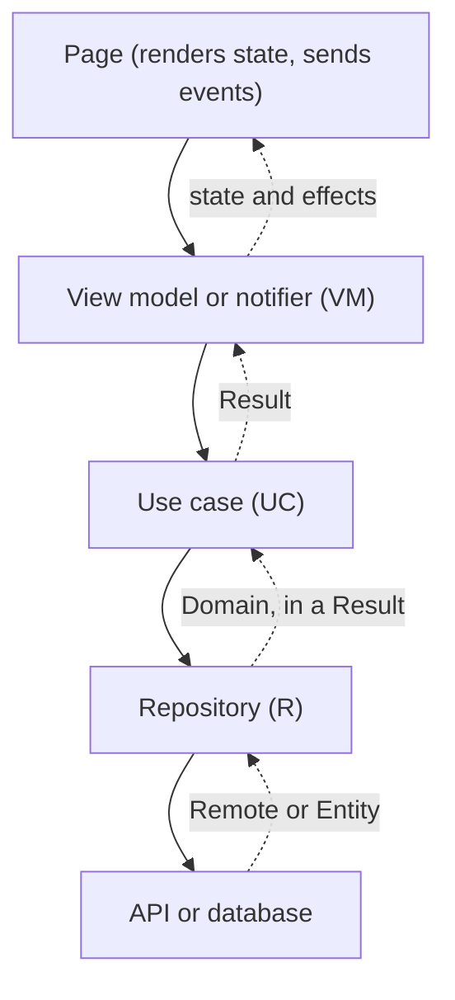

# How it fits together

## The layers

A screen's work flows through four layers. Each one has a short code that ends up in every failure, so a support report points at the exact call.

- The **repository** talks to the API or the database. It maps what it gets (`Remote`, `Entity`) to a **domain** model.
- Everything returns a `Result`: a `Success` that carries the backend's message, or a typed `Failure`.
- The **view model** turns a `Result` into **state** (what the page renders) and **effects** (one-time reactions).

## A failure is translated once

Where a call can fail, a **guard** wraps it (`processApiCall`, `processStorageCall`, `processCall`). It turns whatever was thrown into a typed `SinewException`, once, with the code of that exact place: `module-layer-function-type`, for example `ORD-R-load-DF`. Layers above only pass it along.

A failure keeps its text as data: a message key with arguments, or the backend's own text. The page renders it, every time it builds, in the current language, so a language switch updates an error already on screen.

## State and effects

State is what the page renders. Effects are one-time reactions, such as a snackbar or a navigation, and are never state, so a rebuild can't repeat them. An effect is delivered once, to one listener, and held until there is one.

## Models stay apart

A `Domain` model is what the app needs, in business language. A `Remote` is what the backend sends, shaped like its JSON, and an `Entity` is what is stored on the device. A backend that renames a field touches one file, the `Remote`, and nothing above it.

## What Sinew leaves to you

Sinew ships the mechanism, and your app ships the configuration: the base URL, the paths, the models, the strings, the screens. It never assumes a backend's JSON keys.

## Next

[Modules](/docs/modules) has one page per module, with its API and its edge cases.
